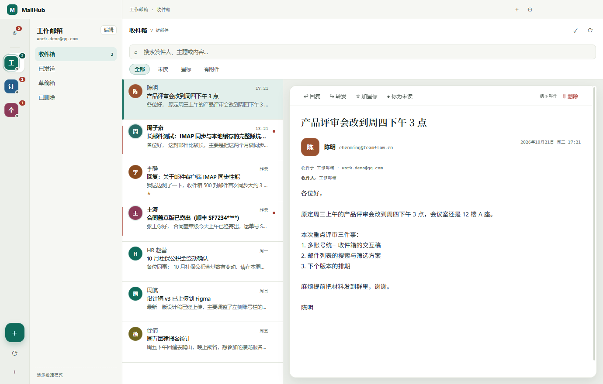
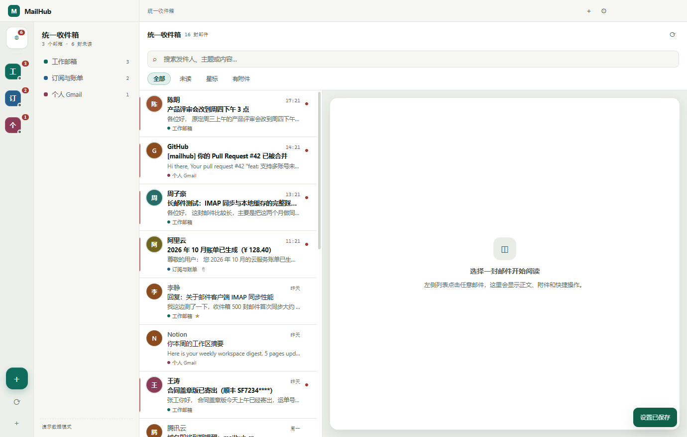
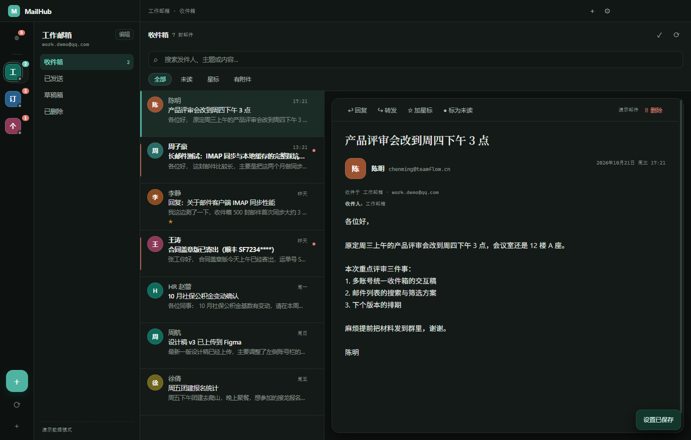
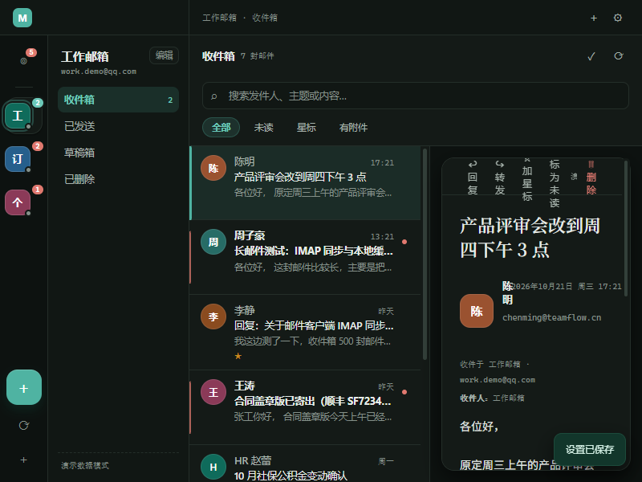

# MailHub 邮箱管家

一个本地运行的多邮箱管理桌面客户端：把好几个邮箱收进同一个窗口，统一看未读、统一搜索、用对应账号直接收发信。关掉窗口后常驻托盘继续收信，新邮件弹桌面提醒。




## 为什么会有这个项目

同时用 QQ、163、Gmail、公司邮箱的人大概都经历过：开四个网页标签，来回切着看未读；桌面客户端要么只支持一家，要么把邮件和账号同步到别人的服务器上。

MailHub 的做法是**直连 IMAP/SMTP**：程序只做本地缓存，账号密码用系统 DPAPI 加密存在本机，不经过任何中间服务器。界面按「分拣台」的思路组织——左边是账户标签，中间是台账和清单，右边是摊开的信纸。

## 界面

| 统一收件箱 | 深色阅读 |
| --- | --- |
|  |  |

| 窄窗口（800px） | 说明 |
| --- | --- |
|  | 四栏自动收窄，不出现横向滚动 |

## 功能

**收信**

- 真实 IMAP 同步，文件夹清单、未读数、最近邮件（默认每文件夹 150 封）
- **IMAP IDLE 即时收信**：每个账号常驻一条 IDLE 连接，服务器有新邮件秒级触发增量同步；断线按 5s→10s→…→5min 退避重连
- 服务器不支持 IDLE 时自动降级为定时轮询（5～60 分钟）
- 统一收件箱：所有账号的收件箱按时间聚合成一个列表，带来源标识
- 新邮件桌面提醒（窗口不在前台才提醒，点通知直接跳到那封邮件）
- 任务栏未读角标、托盘红点

**写信**

- 写 / 回复 / 转发 / 回复全部，抄送密送、签名
- 附件支持点击添加，也支持**把文件直接拖进写信窗口**
- 写到一半关掉自动存本地草稿（含附件路径），重开时恢复并检查文件是否还在
- 「已发送」里回复会发给原收件人，不会写成给自己
- 信封发件人强制等于登录账号；发送后按 `Message-ID` 查重，服务商已自动存副本时不再重复追加

**组织与检索**

- 按发件人 / 主题 / 摘要 / 收件人搜索；未读、星标、有附件筛选
- 标为已读 / 未读、加星标、删除（有回收站则移动，否则彻底删除）
- 危险操作统一走应用内确认弹窗，不用系统对话框
- 点阅读区的发件人即可直接给他写信

**阅读**

- HTML 正文在沙箱 iframe 渲染，默认屏蔽远程图片与追踪像素，点「显示图片」才放行
- 纯文本邮件降级显示；`cid:` 内嵌图片自动内联
- 长邮件自适应高度，滚轮停在正文上也能整页滚动
- 深色模式下正文跟随：浅色底压暗、深色字提亮、图片保持原样（可单独关闭）

**外观与桌面**

- 分拣台四栏布局，账户用彩色标签区分身份，未读用邮戳红标记
- 浅色 / 深色 / 跟随系统，界面、窗口底色、邮件正文一起切换
- 自绘标题栏跟随主题，整条可拖动窗口
- 关闭窗口最小化到托盘；托盘菜单可立即同步、切换提醒 / 自启
- 开机自启（写 `HKCU\...\Run`）
- 演示模式：不用真实邮箱就能看全部界面

## 快速开始

**要求**：Windows 10 / 11、Node.js ≥ 20、npm ≥ 9

```bash
git clone https://github.com/proacane/mailhub.git
cd mailhub
npm install
npm start
```

如果本机已经全局装过 Electron，也可以直接 `electron .`。

> 某些网络环境下 `npm install` 会跳过 Electron 二进制下载，此时装一次 `npm i -D electron` 或直接用全局 `electron` 启动。

想先看界面、不填真实邮箱：

```powershell
# PowerShell
$env:MAILHUB_DEMO="1"; npm start
```

```bash
# bash
MAILHUB_DEMO=1 npm start
```

演示数据写在独立目录，不会碰真实账号数据。

## 添加邮箱

添加账号时选服务商会自动填服务器地址，**密码一栏填的不是登录密码**：

| 邮箱 | 需要准备 | 说明 |
| --- | --- | --- |
| QQ 邮箱 | 授权码 | 「设置 → 账号 → POP3/IMAP/SMTP 服务」开启 IMAP，生成授权码 |
| 163 / 126 | 客户端授权码 | 「设置 → POP3/SMTP/IMAP」开启 IMAP，生成授权码 |
| Gmail | 应用专用密码 | 先开两步验证，再到「安全性 → 应用专用密码」生成 16 位密码；直接填 Google 密码会认证失败 |
| Outlook / Hotmail | 暂不支持 | 微软已关闭 IMAP/SMTP 基础密码认证，必须走 OAuth2，当前版本未接入 |
| 企业 / 自建域名 | 服务器地址 | 手动填 IMAP / SMTP 主机与端口（993 / 465；用 587 记得取消 SSL 勾选） |

保存前可以点「测试连接」，会分别验证 IMAP 和 SMTP，并把失败原因翻译成人话（认证失败、域名解析失败、端口拒绝、证书错误、超时等）。

## 窗口、托盘与退出

- 点关闭（或 Alt+F4）→ **窗口隐藏到托盘**，后台继续收信，第一次会弹提示
- 点托盘图标 / 托盘菜单「打开主窗口」→ 窗口回来
- 托盘菜单可直接切换「最小化到托盘」「新邮件提醒」「开机自启」，也能「立即同步」
- 真正退出：托盘右键 → **退出 MailHub**，或先关掉设置里的「关闭窗口时最小化到托盘」再关窗口
- 未读数同时体现在托盘图标、托盘提示文字和任务栏角标上

## 设置项

- **主题**：跟随系统 / 浅色 / 深色；深色下正文是否跟随可单独开关
- **邮件签名**：自动追加到新邮件正文末尾
- **远程图片**：默认拦截，勾选后新打开的邮件直接加载（会暴露 IP）
- **关闭窗口时最小化到托盘**：默认开启
- **新邮件桌面提醒**：默认开启，前台不打扰；旁边有「发一条测试提醒」
- **后台自动同步**：关闭 / 5 / 10 / 15 / 30 / 60 分钟，改完立即生效
- **开机自动启动**：写 `HKCU\Software\Microsoft\Windows\CurrentVersion\Run` 下 `MailHub` 项；开发模式登记 `electron.exe` + 项目路径，打包后指向程序本体
- **本地存储**：显示缓存占用，可一键清理（账号配置和密码不受影响）

## 技术栈

| 层 | 选型 | 说明 |
| --- | --- | --- |
| 外壳 | Electron 43 | 主进程 Node，渲染层没有构建步骤 |
| 收信 | [imapflow](https://imapflow.com/) | 自带 IDLE、连接池能力 |
| 发信 | [nodemailer](https://nodemailer.com/) | SMTP + APPEND 副本 |
| 解析 | [mailparser](https://nodemailer.com/extras/mailparser/) | 正文、附件、`cid` 内联 |
| 界面 | 原生 HTML / CSS / ES 模块 | 无框架、无打包、无运行时依赖 |
| 打包 | electron-builder 26 | NSIS per-user 安装包 |

**架构约定**

- 渲染进程开启 `contextIsolation` + `sandbox`，禁用 `nodeIntegration`
- 所有网络、文件、系统操作都在主进程，通过 preload 暴露的**白名单 IPC** 调用，统一返回 `{ ok, data | error }`
- 邮件 HTML 在 `srcdoc` iframe 中渲染，沙箱禁用脚本，CSP 默认拦截外部图片
- 样式令牌集中在 `renderer/styles.css` 的 `:root` / `:root[data-theme='dark']`，改主题只改这一处

## 目录结构

```
mailhub/
├─ main/                 主进程
│  ├─ main.js            应用生命周期、窗口、托盘、退出策略
│  ├─ ipc.js             IPC 接口层（统一 {ok,data|error} 返回）
│  ├─ store.js           账号/缓存/正文持久化 + 密码加解密 + 缓存统计清理
│  ├─ mail.js            IMAP 连接池、文件夹、同步、正文解析、标记与删除
│  ├─ sender.js          SMTP 发信 + 副本 APPEND 到已发送
│  ├─ providers.js       服务商预设与邮箱域名识别
│  ├─ sync-manager.js    后台定时同步调度 + 单账号增量同步 + 新邮件识别
│  ├─ idle-manager.js    IMAP IDLE 常驻连接、断线重连、推送状态上报
│  ├─ notifier.js        桌面通知
│  ├─ tray.js            托盘图标与菜单
│  └─ demo.js            演示数据
├─ preload/preload.js    contextBridge 白名单 API
├─ renderer/             渲染层（原生 ES 模块，无打包）
│  ├─ index.html
│  ├─ styles.css         设计令牌 + 分拣台布局
│  └─ app.js             状态管理、列表/阅读/写信/设置
├─ assets/               图标（icon / tray / 未读角标）
├─ build/                electron-builder 配置与 NSIS 脚本
├─ docs/screenshots/     README 截图
└─ scripts/make-icons.mjs  纯 Node 重新生成上述 PNG 图标
```

## 数据与安全

- **数据目录**
  - 安装版：`<安装目录>\data`，跟着程序走（装到 D 盘，账号和邮件就在 D 盘）
  - 开发运行：`%APPDATA%\MailHub\data`
  - 环境变量 `MAILHUB_DATA_DIR` 优先级最高，可指定到别处
  - 只有 Electron 自己的 profile（缓存、GPU、localStorage）必须在 `%APPDATA%\MailHub`
- **升级与迁移**：从旧版本升级时，如果 `%APPDATA%\MailHub\data` 有数据而安装目录还没有，首次启动会**复制**一份过去（旧目录保留作备份，不删）
- **覆盖升级**：直接运行新版本安装包，`build/installer.nsh` 会在升级时保留 `data\`，只替换程序文件
- **卸载**会连同 `<安装目录>\data` 一起删除，卸载前请自行备份
- **存储结构**
  - `accounts.json`：账号配置，**密码用 Electron `safeStorage` 加密**（Windows 走 DPAPI，只有当前用户能解）
  - `cache/<accountId>.json`：邮件列表元数据
  - `bodies/<accountId>/...`：正文与附件
- 账号删除会同时清掉该账号的本地缓存，服务器上的邮件不受影响

> 系统不支持安全存储时，程序会退化为本地编码保存并在设置里提示风险。公共电脑上不建议勾选「记住密码」。

## 打包

```powershell
npm run dist        # 产物：dist\MailHub-Setup-<version>.exe
```

- per-user 安装，不需要管理员权限，默认装到 `%LOCALAPPDATA%\Programs\MailHub`
- 图标取自 `build/icon.ico`（16–256 多尺寸）
- 未做代码签名，首次运行 SmartScreen 会提示「未知发布者」，点「更多信息 → 仍要运行」
- 仓库不含 `dist/` 与 `node_modules/`；安装包见 [Releases](https://github.com/proacane/mailhub/releases)
- 本机没有 `node_modules/electron` 时 electron-builder 会自动下载对应版本；想复用已有安装可设 `ELECTRON_OVERRIDE_DIST_PATH` 指向 Electron 的 `dist` 目录

## 测试

仓库根目录的 `qa-*` 脚本不参与打包，用来自动回归。它们启动真实 Electron（演示模式）或用假实现替换网络层，数据写进临时的 `.qa-data*`，**不碰真实邮箱**：

| 脚本 | 覆盖内容 | 用例 |
| --- | --- | --- |
| `node qa-ui.mjs` | 界面/头像/深色正文/确认弹窗/滚动，CDP 驱动 | 29 |
| `node qa-layout.mjs` | 四栏宽度、账户/文件夹切换、信纸圆角与衬线标题、邮戳红未读 | 17 |
| `node qa-titlebar.mjs` | 标题栏高度/拖动区/按钮留白/主题跟随/「已发送」回信对象 | 11 |
| `node qa-compose.mjs` | 拖拽上传附件（派发真实文件）、草稿附件恢复、附件丢失拦截 | 10 |
| `node qa-visual.mjs` | 亮暗两套主题的对比度（含标题栏）、横向溢出、1024/800 窄窗口 | 度量 |
| `node qa-send.cjs` | 发信单测（替换 nodemailer）：信封地址、Message-ID 去重、失败回退 | 9 |
| `node qa-idle.cjs` | IDLE 逻辑单测（假 ImapFlow）：能力判断、防抖、退避、认证失败停机 | 20 |
| `node qa-idle-real.cjs` | 本地最小 IMAP 服务器 + 真实 imapflow，验证 IDLE 推送能触发同步 | 7 |
| `node qa-packaged.mjs` | 打包产物冒烟（先 `npm run pack`，需放在英文路径下运行） | 9 |
| `node qa-payload.cjs` | 从安装包里拆 asar，核对新功能确实进包 | 11 |

`qa-ui` 的截图与结果落在 `.qa-shots\`。

## 常见问题

**安装时 SmartScreen 拦截？**
没有代码签名，属正常现象：点「更多信息 → 仍要运行」。

**安装后双击没反应 / 进程闪退？**
先确认安装路径全是英文。Chromium 沙箱在非 ASCII 路径下会以 `0x80000003` 崩溃——安装器默认路径是英文的，手动改路径时别带中文。

**「已发送」里出现两封一样的信？**
MailHub 发完会等 1.2 秒按 `Message-ID` 查重，多数服务商（QQ / 163 / Gmail）会自己存副本，查到就不重复追加。个别服务商入库特别慢时仍可能多一封，属已知限制。

**Gmail 提示认证失败？**
用 Google 密码一定失败，必须开两步验证后生成 16 位应用专用密码。

**换电脑 / 重装系统后账号怎么办？**
把 `<安装目录>\data`（或 `%APPDATA%\MailHub\data`）整个目录拷过去即可。密码用 DPAPI 加密、绑定当前 Windows 用户，换机器需要重新输入一次。

**托盘图标点了窗口不出来？**
检查是否被其他窗口挡住，或从托盘菜单选「打开主窗口」；也可以在任务管理器确认 MailHub 是否只剩后台进程。

## 已知限制

- 本地搜索只覆盖已缓存的标题与摘要，不做服务器端全文检索
- Outlook 系列需要 OAuth2，暂未支持
- IDLE 只覆盖收件箱，已发送 / 自定义文件夹仍靠定时轮询；个别企业邮箱不支持 IDLE，会显示在设置的推送状态里
- 草稿只存本地，不回写服务器「草稿箱」
- 深色正文是启发式映射：背景图（渐变 / 图片底）无法识别，极少数营销邮件对比度可能不佳，可在设置里关掉「正文跟随深色」
- 开机自启是 Windows 实现（注册表 Run 项），macOS / Linux 走 Electron 自带登录项接口
- 自绘标题栏只对 Windows 生效，macOS / Linux 仍用系统标题栏

## 路线图

- [ ] Gmail / Outlook 的 OAuth2 授权（打通微软系）
- [ ] 服务器端搜索（IMAP SEARCH）与按会话聚合
- [ ] 富文本写信、草稿回写服务器
- [ ] 自动更新（electron-updater）与签名证书

## 贡献

欢迎 Issue 和 PR。提之前建议：

1. 先跑一遍 `node qa-ui.mjs`，确认不是你本地环境的问题
2. 改界面的话，`node qa-visual.mjs` 的对比度和溢出检查应保持通过
3. 代码风格跟随现有代码：主进程纯 CommonJS、渲染层原生 ES 模块、不加构建步骤、颜色写进 CSS 变量
4. 提交信息用中文或英文都可以，一句话说清「改了什么、为什么」

## 许可证

[MIT](LICENSE) © 2026 ACA

## 致谢

- [imapflow](https://imapflow.com/)、[nodemailer](https://nodemailer.com/)、[mailparser](https://nodemailer.com/extras/mailparser/) — 收信、发信、解析
- [Electron](https://www.electronjs.org/)、[electron-builder](https://www.electron.build/) — 桌面外壳与安装包
- 设计参考了实体邮件分拣台的布局思路